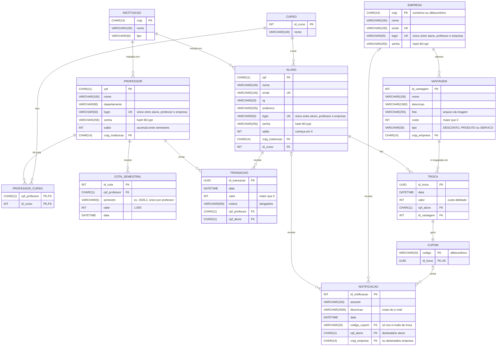

# Modelo de Dados

Os diagramas das Sprints 1 e 2 divergiam entre si e das [histórias de usuário](../Sprint%201/Historias%20de%20Usuario.md) em vários pontos. Este documento registra cada divergência e a decisão tomada, e descreve o modelo reconciliado, que o código em `backend/` segue. Os diagramas foram [atualizados](#diagramas-atualizados) de acordo.

Critério usado em cada divergência: valem as histórias de usuário, que são a especificação mais completa, e entre os diagramas, a versão que as atende.

## Divergências e decisões

| # | Divergência | Onde aparece | Decisão |
| :-: | :--- | :--- | :--- |
| 1 | `Moeda` (uma por professor, com assinatura e critérios), `Carteira` (saldo do aluno por moeda) e `Transferencia` entre alunos, com aprovação (`StatusTransferencia`) | Diagrama de Classes e Diagrama Relacional | **Removidas.** Existe uma moeda só (o Ego) e o saldo é uma coluna de `ALUNO` e de `PROFESSOR`, como no MER (nas duas versões que existiram). Nenhuma história, caso de uso ou o diagrama de componentes prevê transferência entre alunos ou moeda por professor, e a `Troca` "paga com" uma única `Moeda` contradiz a HU09: o aluno precisa poder trocar tudo o que recebeu, de qualquer professor, por uma vantagem. |
| 2 | RG e endereço do aluno | Pedidos pela HU02; ausentes no Relacional e no MER, e o Diagrama de Classes não tem endereço | Incluídos em `ALUNO`. |
| 3 | Login e senha | A HU01 dá login a aluno, professor e empresa; o Relacional só os tem em `ALUNO` e `PROFESSOR`; o `Mer.drawio.png` não os tem em nenhuma entidade | `login` e `senha` em `ALUNO`, `PROFESSOR` e `EMPRESA`. Não há tabela `USUARIO`: a classe abstrata `Usuario` vira colunas em cada perfil. O login é único no sistema todo, entre os três perfis (a tela de login é uma só). A senha é guardada como hash BCrypt. |
| 4 | Saldo do aluno | O MER tem `saldo` em Aluno; o Relacional usa `CARTEIRA` | Coluna `saldo` em `ALUNO`, começando em 0 (HU02, HU11). |
| 5 | Descrição, foto e custo da vantagem | Pedidos pelas HU08/HU09 e presentes no Diagrama de Classes; ausentes no Relacional | Incluídos em `VANTAGEM`. |
| 6 | Mensagem da transação | Pedida pelas HU06, HU07, HU11 e HU12 (`motivo` no Diagrama de Classes); ausente no Relacional | Coluna `motivo` em `TRANSACAO`. |
| 7 | Identificador de transação e de troca | UUID na HU06 e no Diagrama de Classes; `INT` no Relacional | UUID. |
| 8 | Instituição do professor como atributo e como relacionamento "Trabalha em" ao mesmo tempo | MER | Só o relacionamento (chave estrangeira `cnpj_instituicao`). |
| 9 | Curso do aluno | A HU02 o lista entre os campos digitados; o Relacional tem a tabela `CURSO` | O curso é escolhido numa lista, como a instituição. |
| 10 | Registro da cota semestral | A HU05 pede que o crédito de 1.000 moedas fique no histórico para auditoria; nenhum diagrama tinha onde guardá-lo | Tabela `COTA_SEMESTRAL`, uma linha por professor e semestre. A chave única (professor, semestre) garante um crédito só por semestre, mesmo que a rotina rode de novo. |
| 11 | Assunto e data da notificação | A HU07 e a HU10 pedem e-mails; `NOTIFICACAO` só tinha a descrição | `assunto` e `data` em `NOTIFICACAO`, que guarda cada e-mail enviado: o assunto é o do e-mail e a data ordena a caixa de e-mails do painel. |
| 12 | Duas versões do MER | `Entidade Relacionamento.png` era cópia, byte a byte, do `DiagramaNãoRelacional.png` que a própria equipe substituiu pelo `Mer.drawio.png` no commit `ce5164e` | A cópia antiga foi removida para não haver dois MERs contraditórios. O que ela tinha a mais (login e senha) está incorporado aqui. |

## Esquema relacional

`PK` chave primária, `FK` chave estrangeira, `UK` valor único.

## API

Todas as tabelas acima estão implementadas. Endpoints que pedem login (coluna "Quem") recebem o token no cabeçalho `Authorization: Bearer <token>`; sem ele, a resposta é 401, e com o perfil errado, 403.

| Recurso | Endpoint | Quem | História |
| :--- | :--- | :--- | :--- |
| Login | `POST /auth/login` | Público | HU01 |
| Sessão | `GET /auth/eu` | Logado | HU01 |
| Listas do cadastro | `GET /instituicoes`, `GET /cursos` | Público | HU02 |
| Alunos | `GET`, `POST /alunos`; `GET`, `PUT`, `DELETE /alunos/{cpf}` | Público | HU02 |
| Extrato do aluno | `GET /alunos/eu/extrato` | Aluno | HU11 |
| Empresas | `GET`, `POST /empresas`; `GET`, `PUT`, `DELETE /empresas/{cnpj}` | Público | HU03 |
| Professor | `GET /professores/eu`, `GET /professores/eu/alunos?busca=` | Professor | HU04, HU06 |
| Extrato do professor | `GET /professores/eu/extrato` | Professor | HU05, HU12 |
| Envio de moedas | `POST /transacoes` | Professor | HU06, HU07 |
| Catálogo | `GET /vantagens`, `GET /vantagens/{id}/foto` | Público | HU09 |
| Vantagens | `POST /vantagens` (multipart, com a foto), `DELETE /vantagens/{id}` | Empresa | HU08 |
| Troca | `POST /trocas` | Aluno | HU09, HU10 |
| Resgates | `GET /trocas` | Empresa | HU10 |
| E-mails recebidos | `GET /notificacoes` | Aluno ou empresa | HU07, HU10 |

Regras:

- **Cadastro:** CPF e CNPJ com dígitos verificadores corretos, com ou sem máscara, e o CNPJ alfanumérico também é aceito. CPF, e-mail e login de aluno não se repetem; CNPJ, e-mail e login de empresa também não. O login não se repete nem entre perfis. Login de 3 a 50 caracteres entre letras minúsculas, números, ponto, hífen e sublinhado; e-mail com domínio completo; senha de 8 a 72 bytes, gravada como hash BCrypt.
- **Login (HU01):** o mesmo aviso para login inexistente e senha errada. O token é assinado pela API (HMAC-SHA256, chave em `egon.token.segredo`) e vale 12 horas.
- **Professores (HU04):** pré-cadastrados na primeira subida, com a senha inicial `professor123` (só para desenvolvimento).
- **Cota (HU05):** 1.000 moedas a cada 1º de janeiro e 1º de julho, somadas ao saldo; a rotina roda também na subida da API, para o semestre que virou com ela desligada.
- **Envio (HU06):** valor inteiro positivo, motivo obrigatório (até 500 caracteres), aluno da mesma instituição do professor e saldo suficiente. Professor e aluno ficam travados no banco durante o envio, para dois envios ao mesmo tempo não gastarem o mesmo saldo.
- **Troca (HU09, HU10):** saldo maior ou igual ao custo; o cupom é um código de 10 caracteres (`ABCDE-23456`, sem 0/O e 1/I), único.
- **E-mails (HU07, HU10):** cada um fica em `NOTIFICACAO` e sai por SMTP depois do commit, se `spring.mail.host` estiver configurado.
- **Exclusões:** aluno com moedas recebidas ou trocas, empresa com vantagem resgatada e vantagem já resgatada não podem ser excluídos: o histórico e os cupons emitidos dependem deles.
- **Erros:** todo erro sai como `{ "codigo", "mensagem", "campos" }`, com `campos` ligando cada campo inválido ao seu aviso.

## Diagramas atualizados

Todas as imagens levam o arquivo do draw.io embutido: para editar, abra o PNG no [diagrams.net](https://app.diagrams.net) (Arquivo › Abrir) e, ao exportar de novo, marque a opção de incluir uma cópia do diagrama. O Diagrama de Classes, o de Componentes e o de Casos de Uso não tinham arquivo-fonte no repositório e foram redesenhados no draw.io a partir das imagens anteriores, com o mesmo conteúdo e arranjo, mais as correções abaixo.

- **[Diagrama Relacional](DiagramaRelacional.png)**: saíram `MOEDA`, `CARTEIRA` e `TRANSFERENCIA`, e `id_moeda` de `TROCA`; `ALUNO` ganhou `rg`, `endereco` e `saldo`; `EMPRESA`, `login` (UK) e `senha`; `VANTAGEM`, `descricao`, `foto` e `custo`; `TRANSACAO`, `motivo`; `id_transacao` e `id_troca` passaram a UUID; entrou `COTA_SEMESTRAL`, no lugar que era da `MOEDA`; `NOTIFICACAO` ganhou `assunto` e `data`; os tipos de texto são os do código, e a coluna de tipos ficou mais larga, porque cortava `VARCHAR(100)`.
- **[MER](Mer.drawio.png)**: `login` e `senha` em Aluno, Professor e Empresa; `rg` e `endereco` em Aluno; `descricao`, `foto` e `custo` em Vantagens; `motivo` em Transação; `assunto` e `data` em Notificação; a entidade Cota Semestral, que o Professor recebe; saiu o atributo Instituição de Professor, que já é o relacionamento "Trabalha em".
- **[Diagrama de Classes](../Sprint%201/Diagrama%20de%20Classes.png)**: saíram `Moeda`, `Carteira`, `Transferencia`, `StatusTransferencia` e `Aluno.solicitarTransferencia()`, e com a `Moeda` saiu a associação "paga com" de `Troca`; `Aluno` ganhou `endereco` e `saldo`; `Notificacao` ganhou `assunto` e `data`; as datas são `LocalDateTime`; entrou a classe `CotaSemestral`, que o `Professor` recebe.
- **[Diagrama de Componentes](Diagrama%20de%20Componentes.png)**: segue a implementação. Entraram as listas do cadastro de aluno (`/instituicoes` e `/cursos`, com controllers, services e o `CursoRepository`), a caixa de e-mails (`/notificacoes`, com `NotificacaoController` e `NotificacaoRepository`), o `CotaSemestralRepository` e, no front-end, as telas de gestão de alunos e de empresas. As dependências entre serviços são as do código: `TransacaoService` usa `AlunoService`, `ProfessorService` e `NotificacaoService`; `TrocaService` usa `AlunoService`, `VantagemService`, `CupomService` e `NotificacaoService`.
- **[Casos de Uso](../Sprint%201/Casos%20de%20Uso.png)**: "Realizar cadstro de empresa" corrigido para "Realizar cadastro de empresa".
