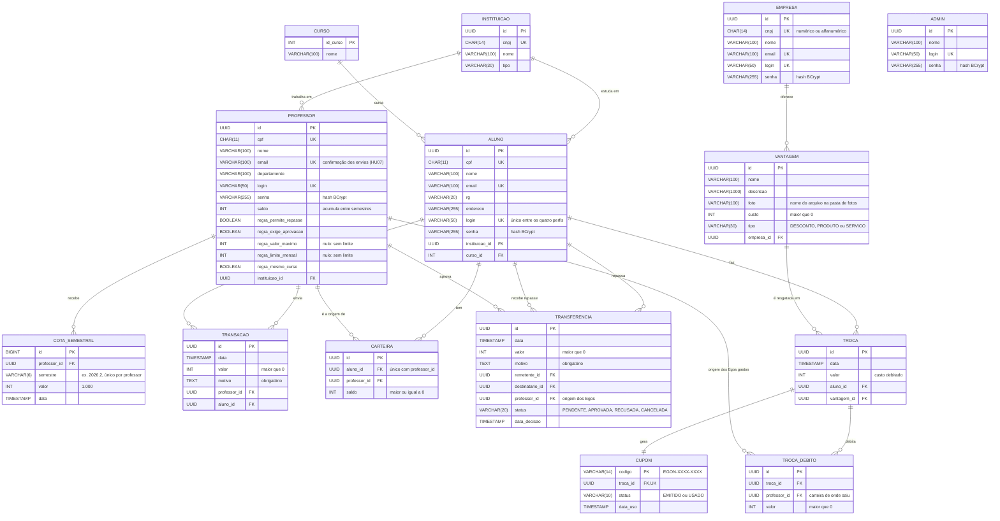

# Modelo de Dados

Os diagramas das Sprints 1 e 2 divergiam entre si e das [histórias de usuário](Historias%20de%20Usuario.md) em vários pontos. Este documento registra cada divergência e a decisão tomada, e descreve o modelo reconciliado, que o código em `backend/` segue. Os diagramas foram [atualizados](#diagramas-atualizados) de acordo; o que a implementação das moedas mudou e ainda falta desenhar está em [mudanças pendentes](#mudanças-pendentes-nos-diagramas).

Critério usado em cada divergência: valem as histórias de usuário, que são a especificação mais completa, e entre os diagramas, a versão que as atende.

## Divergências e decisões

| # | Divergência | Onde aparece | Decisão |
| :-: | :--- | :--- | :--- |
| 1 | `Moeda` (uma por professor, com assinatura e critérios), `Carteira` (saldo do aluno por moeda) e `Transferencia` entre alunos, com aprovação (`StatusTransferencia`) | Diagrama de Classes e Diagrama Relacional | **Removidas.** Existe uma moeda só (o Ego) e o saldo é uma coluna de `ALUNO` e de `PROFESSOR`, como no MER (nas duas versões que existiram). Nenhuma história, caso de uso ou o diagrama de componentes prevê transferência entre alunos ou moeda por professor, e a `Troca` "paga com" uma única `Moeda` contradiz a HU09: o aluno precisa poder trocar tudo o que recebeu, de qualquer professor, por uma vantagem. **Revista na rodada 2 (linha 20):** a moeda por professor e a transferência entre alunos voltaram, com outra forma, a pedido do produto. |
| 2 | RG e endereço do aluno | Pedidos pela HU02; ausentes no Relacional e no MER, e o Diagrama de Classes não tem endereço | Incluídos em `ALUNO`. |
| 3 | Login e senha | A HU01 dá login a aluno, professor e empresa; o Relacional só os tem em `ALUNO` e `PROFESSOR`; o `Mer.drawio.png` não os tem em nenhuma entidade | `login` e `senha` em `ALUNO`, `PROFESSOR` e `EMPRESA`. Não há tabela `USUARIO`: a classe abstrata `Usuario` vira colunas em cada perfil. O login é único no sistema todo, entre os três perfis (a tela de login é uma só). A senha é guardada como hash BCrypt. |
| 4 | Saldo do aluno | O MER tem `saldo` em Aluno; o Relacional usa `CARTEIRA` | Coluna `saldo` em `ALUNO`, começando em 0 (HU02, HU11). |
| 5 | Descrição, foto e custo da vantagem | Pedidos pelas HU08/HU09 e presentes no Diagrama de Classes; ausentes no Relacional | Incluídos em `VANTAGEM`. |
| 6 | Mensagem da transação | Pedida pelas HU06, HU07, HU11 e HU12 (`motivo` no Diagrama de Classes); ausente no Relacional | Coluna `motivo` em `TRANSACAO`. |
| 7 | Identificador de transação e de troca | UUID na HU06 e no Diagrama de Classes; `INT` no Relacional | UUID. |
| 8 | Instituição do professor como atributo e como relacionamento "Trabalha em" ao mesmo tempo | MER | Só o relacionamento (chave estrangeira `cnpj_instituicao`). |
| 9 | Curso do aluno | A HU02 o lista entre os campos digitados; o Relacional tem a tabela `CURSO` | O curso é escolhido numa lista, como a instituição. |
| 10 | Registro da cota semestral | A HU05 pede que o crédito de 1.000 moedas fique no histórico para auditoria; nenhum diagrama tem onde guardá-lo | **Confirmada com a HU05:** tabela `COTA_SEMESTRAL`, uma linha por professor e semestre (o par é único). O crédito só acontece se a linha do semestre não existir, então rodar de novo não credita duas vezes. |
| 11 | Duas versões do MER | `Entidade Relacionamento.png` era cópia, byte a byte, do `DiagramaNãoRelacional.png` que a própria equipe substituiu pelo `Mer.drawio.png` no commit `ce5164e` | A cópia antiga foi removida para não haver dois MERs contraditórios. O que ela tinha a mais (login e senha) está incorporado aqui. |
| 12 | Identidade sem login | A HU01 pede login e senha a todo perfil | **Superada (linha 19).** Na rodada 1 a identidade era o CPF na URL e a tela Entrar listava as pessoas sem senha; a rodada 2 implementou a HU01. |
| 13 | E-mail como canal de aviso | HU07 e HU10, ator Sistema e Diagrama de Componentes (servidor de e-mail, caixa de e-mails em `/notificacoes`) | **Revista (linha 36): e-mail e aviso no app na HU07.** O enunciado pede que o aluno seja notificado por e-mail. A cada envio confirmado saem dois e-mails, cada um com o seu template, e continua o aviso ao vivo por WebSocket (`/ws/notificacoes`) ao aluno (moedas recebidas) e ao professor (envio confirmado). O texto do aviso no app é montado no front, em `frontend/src/content.ts`. O cupom (HU10) segue só no app (linha 38). |
| 14 | Uso de `NOTIFICACAO` | A matriz de rastreabilidade a ligava às HU07 e HU10; o Diagrama de Componentes, aos e-mails das duas | **Revista (linha 39): saiu do modelo.** A tabela nunca existiu no código; os avisos são ao vivo e os e-mails da HU07 não precisam de histórico próprio. |
| 15 | Saídas no extrato do aluno | A HU11 pede entradas e saídas (trocas); as trocas dependem das HU09 e HU10 | **Pendência.** Até a HU09, `GET /alunos/{cpf}/extrato` lista só os recebimentos. |
| 16 | `PROFESSOR_CURSO` | Diagrama Relacional, MER ("Dá aula de") e Diagrama de Classes; nenhuma história a usa | **Revista (linha 39): saiu do modelo**, com o relacionamento "Dá aula de" e a associação Curso–Professor do Diagrama de Classes: nenhuma funcionalidade a usa e o código não a tem. |
| 17 | Exclusão de aluno com histórico | O CRUD da Sprint 2 exclui qualquer aluno; a HU12 pede o histórico de envios do professor, que aponta para o aluno | **Bloqueada.** `DELETE /alunos/{cpf}` de quem já recebeu Egos responde 409 `ALUNO_COM_TRANSACOES`. Sem transações, exclui como antes. Na rodada 2, também quem repassou ou recebeu repasse (HU13). |
| 18 | Cota no extrato do professor | A HU12 cita só as transferências feitas; a HU05 manda registrar a cota no histórico | **Entra no extrato.** `GET /professores/{cpf}/extrato` traz os envios (`ENVIO`) e os créditos semestrais (`COTA`). |
| 19 | Login (HU01) | A HU01 dá login a todos os perfis; a rodada 1 a deixou de fora | **Implementada.** Spring Security com sessão no servidor (cookie HttpOnly) para aluno, professor, empresa e admin; cada endpoint diz quais perfis e qual pessoa podem usá-lo. CSRF por cookie `XSRF-TOKEN` devolvido no cabeçalho `X-XSRF-TOKEN`. Login inexistente e senha errada têm a mesma resposta. |
| 20 | Moeda por professor e repasse entre alunos | Pedido na rodada 2; contraria a decisão da linha 1 | **Implementados (HU13).** Cada Ego guarda o professor de origem: tabela `CARTEIRA` (aluno, professor, saldo) e o saldo do aluno vira a soma das carteiras (sai a coluna `ALUNO.saldo`). Tabela `TRANSFERENCIA` com status `PENDENTE`, `APROVADA`, `RECUSADA` ou `CANCELADA`. As regras de repasse ficam em colunas `regra_*` de `PROFESSOR`. A troca por vantagem (HU09), quando existir, decide de quais carteiras debita. |
| 21 | Chave primária com CPF e CNPJ | Diagrama Relacional e MER usam o documento como chave | **Trocada por UUID.** `ALUNO`, `PROFESSOR`, `EMPRESA`, `INSTITUICAO`, `ADMIN`, `VANTAGEM`, `CARTEIRA` e `TRANSFERENCIA` têm chave `id` (UUID); CPF e CNPJ viram colunas únicas. As chaves estrangeiras passam a ser `*_id`. O documento sai das URLs e das relações. Como o `ddl-auto=update` não troca chave primária, o banco de dev passou para `data/egon2`. |
| 22 | Admin | Nenhum diagrama nem história tinha quem cadastra instituições e professores | **Ator novo (HU14).** Tabela `ADMIN` (id, nome, login, senha); um admin na carga inicial (`admin`, senha de `EGON_ADMIN_SENHA`, `admin12345` em dev). O admin faz o pré-cadastro da HU04 e o CRUD de instituições, cursos, alunos, empresas e admins. |
| 23 | Cota do professor cadastrado no meio do semestre | A HU05 credita na virada do semestre | **Na hora.** O professor criado pelo admin recebe a cota do semestre atual ao ser cadastrado. |
| 24 | Exclusões que apagariam histórico | CRUDs completos da rodada 2 | **Bloqueadas com 409:** instituição com alunos ou professores (`INSTITUICAO_EM_USO`), curso com alunos (`CURSO_EM_USO`), professor que já enviou (`PROFESSOR_COM_TRANSACOES`), admin que exclui a si mesmo ou o último (`ADMIN_PROTEGIDO`). Excluir empresa apaga as vantagens e as fotos dela (ainda não há troca que dependa delas). |
| 25 | Vantagem (HU08) | Diagrama de Classes tinha `Vantagem`; nada implementado | **Implementada, com edição e exclusão.** Foto JPEG, PNG ou WebP de até 2 MB, conferida pelos bytes, gravada em pasta (`egon.fotos.pasta`) com nome gerado; o arquivo antigo só sai depois do commit. |
| 26 | Autoedição | O CRUD da Sprint 2 era aberto | **Aluno e empresa editam o próprio cadastro** (CPF e CNPJ não mudam); professor é editado pelo admin e define só as regras de repasse. |
| 27 | Transações, cotas e transferências decididas | CRUDs completos | **Sem edição nem exclusão:** são o histórico que sustenta os saldos. |
| 28 | Dashboards | Pedidos na rodada 2 | Um painel em bento por perfil (`/painel`). O do admin mostra a conta dos Egos: emitidos pela cota = com professores + nas carteiras + reservados em repasses pendentes. |
| 29 | Modo dev | Pedido na rodada 2 para testar à mão | Login sem senha por `/dev/contas` e `/dev/entrar`, aberto no front pelo código Konami na tela de login. **Só existe com `egon.dev=true`** (perfil `dev` do Spring ou `EGON_DEV=true`); desligado, que é o padrão, as rotas nem existem. |
| 30 | Diagramas de Casos de Uso e de Classes | HU13 e HU14 não têm caso de uso; `Admin`, `Carteira` e `Transferencia` (nova forma) não estão nas classes | **Pendente** nos PNGs (ver "Mudanças pendentes nos diagramas"). |
| 31 | Resgate com moeda por professor | A HU09 pede debitar o custo; com carteiras por professor (linha 20), era preciso decidir de quais | **Maior carteira primeiro** (empate pelo nome do professor), com o quanto saiu de cada uma gravado em `TROCA_DEBITO`. |
| 32 | Cupom e conferência (HU10) | O modelo tinha `CUPOM` (código) sem estado nem conferência | `CUPOM` ganha `status` (`EMITIDO`, `USADO`) e `data_uso`. Código `EGON-XXXX-XXXX` (40 bits de `SecureRandom`, alfabeto de Crockford). QR code gerado no front (`qrcode-generator`) com o link `/painel?cupom=…`. A empresa confere e confirma; confirmar de novo dá 409 `CUPOM_USADO`; cupom de outra empresa responde 404. |
| 33 | Avisos do cupom e WebSocket da empresa | A HU10 manda avisar aluno e empresa | Aviso ao vivo `CUPOM` (`EMITIDO` ao aluno e à empresa, `USADO` ao aluno); a empresa passa a poder conectar no WebSocket. A tabela `NOTIFICACAO` continua sem uso: o histórico está nas listas de cupons. |
| 34 | Exclusões com resgate | A linha 24 deixava excluir empresa com vantagens porque ainda não havia troca | **Revista:** vantagem ou empresa com resgate não sai (409 `VANTAGEM_COM_RESGATES`, `EMPRESA_COM_RESGATES`). |
| 35 | Conta dos Egos com resgate | O resgate tira Egos do sistema | `emitidos = comProfessores + comAlunos + reservados + resgatados` no resumo do admin. |
| 36 | E-mails da HU07 e e-mail do professor | O enunciado pede e-mail ao aluno que recebe moedas; a HU07 pede a confirmação do envio ao professor, que não tinha e-mail em nenhum modelo nem no código | **Implementados.** `PROFESSOR.email` (`VARCHAR(100)`, único e obrigatório), informado pelo admin no cadastro e na edição; a carga inicial dá aos quatro professores e-mails institucionais fictícios. Depois do commit de cada envio, o `EmailsDaTransacao` manda, numa thread à parte (`@Async`), um e-mail ao aluno (`templates/email/moedas-recebidas.html`) e outro ao professor (`templates/email/envio-confirmado.html`), gerados com Thymeleaf. Sem `spring.mail.host` o e-mail não sai e fica no log; falha de SMTP não desfaz o envio. O banco de dev passou para `data/egon3`, porque o `ddl-auto=update` não acrescenta coluna obrigatória e única numa tabela com professores. |
| 37 | Diagramas de sequência | O enunciado da disciplina pede a realização dos casos de uso | **Criados em `docs/Sprint 3/Diagramas de Sequencia`**, um por caso de uso do Diagrama de Casos de Uso, no padrão dos slides (A.08). Cada mensagem é uma operação que existe no código; as classes de domínio que aparecem neles estão no Diagrama de Classes. |
| 38 | Cupom por e-mail (HU10) | O enunciado pede e-mail de cupom ao aluno e à empresa, com o código | **Pendente.** O resgate gera o cupom e avisa os dois no app (linha 33), mas ainda não manda e-mail. O mesmo `EnvioDeEmail` da linha 36 serve para isso, com dois templates novos. |
| 39 | Diagramas da Sprint 3 | Os diagramas da Sprint 1 e 2 não acompanhavam as rodadas 2 a 4 (linha 30 e "Mudanças pendentes" da versão anterior) | **Refeitos a partir do código**, nesta pasta: Casos de Uso com o Admin e os casos de repasse, cupom e administração; Classes; Componentes (completo e reduzido) com a estrutura real de controllers, services e repositórios; Relacional gerado do DDL do Hibernate; MER com as 14 entidades; um diagrama de sequência por caso de uso. Saíram `NOTIFICACAO` e `PROFESSOR_CURSO`. As versões anteriores ficam na Sprint 1 e na Sprint 2. |

## Esquema relacional

`PK` chave primária, `FK` chave estrangeira, `UK` valor único. Toda chave `id` é UUID, menos `CURSO` (inteiro) e `COTA_SEMESTRAL` (BIGINT).



São as 14 tabelas que o Hibernate cria a partir das entidades (o DDL foi conferido com a exportação do próprio Hibernate). Os avisos não têm tabela: são ao vivo, e o histórico está nos extratos e nas listas de cupons.

## O que já está implementado

Rodada 1: `INSTITUICAO`, `CURSO`, `ALUNO`, `EMPRESA`, `PROFESSOR`, `COTA_SEMESTRAL` e `TRANSACAO`, com o envio de moedas, o aviso ao vivo e os extratos (HU02 a HU07, HU11, HU12). Rodada 2: login (HU01), `ADMIN` e os CRUDs (HU04, HU14), `VANTAGEM` (HU08), `CARTEIRA` e `TRANSFERENCIA` (HU13), ids UUID e os dashboards.

### Quem acessa o quê

Sem sessão → 401 `NAO_AUTENTICADO`; perfil ou pessoa errados → 403 `ACESSO_NEGADO`; escrita sem o token de CSRF certo → 403 `CSRF_INVALIDO`. "O próprio" é a pessoa logada cujo id está no caminho.

| Endpoint | Quem |
| :--- | :--- |
| `POST /auth/login`, `GET /auth/eu`, `POST /auth/logout` | Todos (o `GET /auth/eu` entrega o cookie de CSRF) |
| `POST /alunos`, `POST /empresas` | Público (cadastro) |
| `GET /instituicoes`, `GET /cursos` | Público (listas do cadastro) |
| `POST`/`PUT`/`DELETE /instituicoes…`, `/cursos…`; `GET`/`POST`/`PUT`/`DELETE /admins…` | Admin |
| `GET /alunos`, `DELETE /alunos/{id}` | Admin |
| `GET`/`PUT /alunos/{id}`, `GET /alunos/{id}/extrato` | O próprio aluno ou admin |
| `GET /alunos/{id}/colegas`, `POST /alunos/{id}/transferencias` | O próprio aluno |
| `GET`/`POST /professores`, `PUT`/`DELETE /professores/{id}` | Admin |
| `GET /professores/{id}`, `GET /professores/{id}/extrato` | O próprio professor ou admin |
| `POST /professores/{id}/transacoes`, `GET /professores/{id}/alunos`, `GET`/`PUT /professores/{id}/regras`, `GET /professores/{id}/transferencias` | O próprio professor |
| `POST /transferencias/{id}/aprovar`, `/recusar` | O professor de origem |
| `POST /transferencias/{id}/cancelar` | O aluno que pediu |
| `GET /empresas`, `DELETE /empresas/{id}` | Admin |
| `GET`/`PUT /empresas/{id}` | A própria empresa ou admin |
| `GET`/`POST /empresas/{id}/vantagens`, `PUT`/`DELETE …/vantagens/{v}` | A própria empresa (GET e DELETE também admin) |
| `GET /vantagens` (catálogo) | Aluno e admin |
| `GET /vantagens/{id}/foto` | Qualquer pessoa logada |
| `POST /alunos/{id}/resgates`, `GET /alunos/{id}/cupons` | O próprio aluno |
| `GET /empresas/{id}/cupons`, `GET /empresas/{id}/cupons/{codigo}`, `POST …/cupons/{codigo}/confirmar` | A própria empresa (cupom de outra empresa: 404) |
| `GET /admin/resumo` | Admin |
| WebSocket `/ws/notificacoes` | Aluno, professor e empresa logados (a pessoa vem da sessão) |
| `GET /dev/contas`, `POST /dev/entrar` | Só com `egon.dev=true`; fora disso não existem |

### Regras

- Cadastros: CPF e CNPJ com dígitos verificadores corretos, com ou sem máscara (CNPJ alfanumérico aceito); CPF, CNPJ, e-mail e login sem repetição (o login, entre os quatro perfis); login de 3 a 50 caracteres em `[a-z0-9._-]`; senha de 8 a 72 bytes, em hash BCrypt, nunca devolvida; na edição, senha em branco mantém a atual.
- Envio (HU06), `POST /professores/{id}/transacoes` com `{ idAluno, valor, motivo }`: valor inteiro > 0, motivo até 500 caracteres, aluno da instituição do professor, saldo suficiente. Erros: `DADOS_INVALIDOS` (400), `ALUNO_NAO_ENCONTRADO` (400, campo `idAluno`), `ALUNO_DE_OUTRA_INSTITUICAO` e `SALDO_INSUFICIENTE` (422). O crédito vai para a carteira aluno+professor.
- Repasse (HU13), `POST /alunos/{id}/transferencias` com `{ destinatarioId, professorId, valor, motivo }`: destinatário existente, outra pessoa, da instituição atual do professor de origem; valor que caiba na carteira daquele professor; regras do professor (`REPASSE_DESATIVADO`, `ACIMA_DO_MAXIMO`, `LIMITE_MENSAL` contando pendentes e aprovadas do mês no fuso de São Paulo, `CURSO_DIFERENTE`). Decidir uma transferência que não está pendente: 409 `TRANSFERENCIA_DECIDIDA`.
- Concorrência: toda operação sobre os Egos de um professor (cota, envio, repasse, decisão) trava a linha dele antes das carteiras, sempre nessa ordem.
- Cota (HU05): 1.000 por semestre (`AAAA.1` jan–jun, `AAAA.2` jul–dez, fuso de São Paulo), na subida, às 00:05 de 1º de janeiro e de 1º de julho e na hora em que o admin cadastra o professor.
- Vantagem (HU08): multipart com `nome`, `descricao`, `custo`, `tipo` e `foto`; erros da foto `FOTO_OBRIGATORIA`, `FOTO_INVALIDA`, `FOTO_GRANDE` (400, campo `foto`).
- Resgate (HU09), `POST /alunos/{id}/resgates` com `{ vantagemId }`: saldo total ≥ custo (senão 422 `SALDO_INSUFICIENTE`); débito pela maior carteira primeiro; gera o cupom (201). Concorrência: trava os professores das carteiras do aluno em ordem de id, depois as carteiras; confirmar trava o cupom.
- Cupom (HU10): `{ codigo, status, data, valor, vantagem, empresa, aluno, dataUso }`; a busca aceita o código em minúsculas, com espaços e sem hífen (O vira 0, I e L viram 1).
- Todo erro sai como `{ "codigo", "mensagem", "campos" }`.

### Extratos e avisos ao vivo

- Extrato: `{ saldo, carteiras, movimentos }`, mais recentes primeiro. `carteiras` só no do aluno: `{ professor: { id, nome }, saldo, regras }`. Movimento: `tipo` (`RECEBIMENTO`, `ENVIO`, `COTA`, `TRANSFERENCIA_ENVIADA`, `TRANSFERENCIA_RECEBIDA`, `RESGATE`), `id`, `data`, `valor` (sempre positivo), `motivo`, `pessoa` (`{ id, nome }`), `semestre` (só cota), `status` e `origem` (só repasse), `cupom` (só resgate, com o motivo sendo a vantagem e a pessoa, a empresa). O destinatário só vê repasses aprovados.
- WebSocket `/ws/notificacoes` (em dev, `/api/ws/notificacoes` pelo proxy do Vite): sem parâmetros; o cookie de sessão vai no handshake. Mensagens, sempre depois do commit, com o `saldo` de quem recebe:

```json
{ "tipo": "MOEDAS_RECEBIDAS", "transacao": { … }, "saldo": 50 }
{ "tipo": "ENVIO_CONFIRMADO", "transacao": { … }, "saldo": 950 }
{ "tipo": "TRANSFERENCIA", "evento": "SOLICITADA", "transferencia": { … }, "saldo": 70 }
{ "tipo": "CUPOM", "evento": "EMITIDO", "cupom": { … }, "saldo": 20 }
```

- `TRANSFERENCIA` vai ao professor de origem e a quem pediu (`SOLICITADA`), a quem pediu e a quem recebe (`APROVADA`), a quem pediu (`RECUSADA`) e ao professor (`CANCELADA`). Os textos ficam em `frontend/src/content.ts`, um por perfil e evento.

### E-mails (HU07)

- A cada envio de moedas confirmado, depois do commit e fora da requisição: e-mail ao aluno (`templates/email/moedas-recebidas.html`, assunto "Você recebeu N Egos de Professor") e ao professor (`templates/email/envio-confirmado.html`, assunto "Envio confirmado: N Egos para Aluno"). Os dois levam nomes, quantia, data (fuso `egon.fuso`), motivo (escapado: entra como texto, nunca como HTML), o saldo de quem recebe o e-mail, o código da transação e o link do painel (`egon.front.url`).
- SMTP pelas propriedades `spring.mail.*` (exemplo comentado no `application.properties`); remetente em `egon.email.remetente`. Sem servidor configurado, o e-mail não sai e fica registrado no log.

### Resumo do admin

`GET /admin/resumo` → `{ egos: { emitidos, comProfessores, comAlunos, reservados, resgatados }, enviosPorMes: [{ mes, quantidade, valor }], porInstituicao: [{ id, nome, alunos, professores, enviado }], contagens: { instituicoes, cursos, alunos, professores, empresas, vantagens } }`. Sempre vale `emitidos = comProfessores + comAlunos + reservados + resgatados`.

## Diagramas da Sprint 3

Todos acompanham o código da `main` e levam o arquivo do draw.io embutido: para editar, abra o PNG no [diagrams.net](https://app.diagrams.net) (Arquivo › Abrir) e, ao exportar de novo, marque a opção de incluir uma cópia do diagrama. As versões anteriores continuam na Sprint 1 e na Sprint 2.

- **[Casos de Uso](Casos%20de%20Uso.png)**: atores Aluno, Professor, Empresa e Admin (com Pessoa e Usuário como generalizações) e 14 casos de uso; entraram Repassar moedas, Aprovar repasse, Definir regras de repasse, Conferir cupom, Manter cadastros e Acompanhar moedas.
- **[Diagrama de Classes](Diagrama%20de%20Classes.png)**: `Professor` com `email`; `Admin`, `Carteira`, `Transferencia` (com `StatusTransferencia`), `RegrasMoeda` (parte do `Professor`), `TrocaDebito` (parte da `Troca`) e `StatusCupom`; `Cupom` com `status`, `dataUso` e `usar()`; sem `Aluno.saldo` (o saldo está nas carteiras); datas em `Instant`; saíram `Notificacao` (não é entidade: uma nota diz de onde saem os avisos e os e-mails) e a associação "dá aula" entre `Curso` e `Professor`.
- **[Diagrama de Componentes](Diagrama%20de%20Componentes.png)**: as sete telas do front, os 12 controllers e o `NotificacaoHandler` (WebSocket) com as suas interfaces, os 17 services (cada um com os repositórios que usa), os eventos publicados depois do commit, os 15 repositórios, o banco, o servidor de e-mail (opcional) e a pasta de fotos. Há também uma [versão reduzida](diagrama-de-componentes-reduzido.png), em blocos de View, Controller e Model.
- **[MER](Mer.drawio.png)**: as 14 entidades, com identificador `id` (o `codigo` no Cupom), as regras de repasse como atributo composto do Professor e a cardinalidade de cada relacionamento.
- **[Diagrama Relacional](DiagramaRelacional.png)**: gerado do esquema que o Hibernate cria das entidades; tipos, `PK`, `FK`, `UK` e `UK*` (único em conjunto) iguais aos do banco.
- **[Diagramas de Sequência](Diagramas%20de%20Sequencia/README.md)**: um por caso de uso, no padrão dos slides da disciplina.

Não há mudanças pendentes nos diagramas: o que o código faz está desenhado, e o que estava no modelo sem existir no código saiu (linha 39). O único pendente é de implementação: o e-mail do cupom (linha 38).
